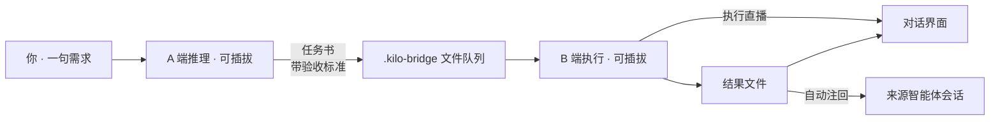

<div align="center">

# 智能体协作桥

**让一个 AI 给另一个 AI 派活 —— A 推理 · B 执行 · 双端可插拔**

你说一句需求，A 端智能体把它整理成带验收标准的任务书，B 端智能体执行并**直播**全过程，结果自动回到对话。


</div>

## ✨ 特性

- 🔌 **双端可插拔** — A 端（推理）与 B 端（执行）独立切换：Kilo / Claude Code / Codex 无头直执，或 ZCode 会话取件模式，网页下拉即换
- 🗂 **项目与对话** — 左侧「项目 → 对话」两级组织；每个对话有独立的多轮记忆，并**绑定 A 端同一个智能体会话**（说"把刚才那个文件改一下"它就懂）
- 📺 **执行直播** — B 端执行时进度实时滚动在气泡里（工具调用 / 步骤 / 文本片段），不再黑箱等待
- 🔁 **返修与注回** — 结果一键"返修"带上下文重投；结果自动注回来源会话，智能体接着结果继续干活
- 🛡 **本地优先** — 仅绑定 127.0.0.1，文件即协议（纯 Markdown 任务书），零 API Key、零云端依赖，你的订阅账号就是凭证
- 🧰 **一键装配** — `node scripts/setup.mjs` 自动发现智能体、接入接口、自检、可选自启
- 🌗 **深浅双主题** 对话式界面（含安全 Markdown 渲染、IME 友好的 Enter 发送、回到最新、复制结果）
- 🧪 **认真工程** — 26 项单元测试、格式校验拒收、滞留告警、注回去重、断线降级轮询、守护自启

## 🚀 快速开始

```bash
git clone <本仓库地址> && cd ai
node scripts/setup.mjs            # 环境检测 + 智能体发现 + 目录初始化 + 自检
# 可选：--kilo-rules 接入 Kilo 会话捕获；--autostart 开机自启；--start 装配后立即启动
npm run bridge-client             # 启动，然后打开 http://127.0.0.1:8791
```

要求：Node.js ≥ 22.5（建议 24）。本机装了 Kilo / Claude Code / Codex 任一 CLI 即可被自动发现并接入（也支持环境变量 `KILO_BIN` / `CLAUDE_BIN` / `CODEX_BIN` 指定路径）。未发现的智能体自动跳过，不影响其余功能。

## 🧩 工作原理



## 🔌 智能体支持矩阵

| 智能体 | A 推理 | B 执行 | 说明 |
| --- | --- | --- | --- |
| **Kilo CLI** | ✅（默认） | ✅ 无头直执 | 支持会话续接与注回（Kilo Gateway 账号） |
| **Claude Code** | ✅ | ✅ 无头直执 | 需已登录（未登录时如实报认证错误） |
| **Codex CLI** | ✅ | ✅ 无头直执 | 沙箱非交互，纯文本汇报 |
| **ZCode 会话** | — | ✅ 取件模式 | 编码计划账号；配合取件自动化使用 |
| **无（直投）** | ✅ | — | 需求不经推理直接入队 |

新增智能体 = 在 `agentAdapters()` 里加一个 `{ path, argv, parseText, canContinue }` 描述。

## 🖥️ 界面

对话式双栏：右侧气泡是你说的话，左侧气泡是 B 端结果（含状态、Markdown 摘要、注回汇报），**同一轮对话同色标识**，8 种淡雅配色轮换；顶部实时状态（连接 / 心跳 / 捕获 / 注回 / 滞留）；底部 A/B 角色选择与输入框。

## 📚 文档

- [智能体桥运行手册](docs/runbooks/kilo-bridge.md) — 部署、运维、故障排查
- [桥接协议 BRIDGE.md](.kilo-bridge/BRIDGE.md) — 任务/结果文件格式与目录状态机
- [D004/D005 复检报告](docs/acceptance/D004-D005-recheck-20261016.md) — 文件桥架构的由来（平台缺口分析）

## 🧪 质量与测试

```bash
npm run test:bridge-client   # 26 项单元测试（协议解析 / 适配器 / 线程隔离 / Markdown 安全渲染）
```

---

## 项目背景：协作工作台

本仓库最初是 Windows 优先的本地桌面 AI 协作工作台（目标与验收合同见 [DESIGN.md](DESIGN.md) 和 [执行总纲](docs/superpowers/plans/2026-10-13-execution/00-execution-guide.md)），智能体协作桥在其文件协议与工程规范之上生长而来。

**范围 v2（2026-10-16）**：本软件仅限用户本人在本机直接使用，不发行、不分发、不做代码签名；未签名内部包（阶段三交付）即最终交付形态。发行/签名/试用/交接专属任务卡（D052/D053/D056/D057/D060）已按 [DEC-010](docs/decisions/scope-v2.md) 取消，质量、语言、恢复等全部产品行为标准不变。

历史进展（阶段二至五的验收证据、冻结记录与回归基线）见 [docs/acceptance/](docs/acceptance/)。桌面端：`npm run build:desktop` 后执行 `npm run desktop`；`npm run desktop:demo` 使用明确标记的模拟模型响应。后端恢复与桌面迁移步骤见 [后端运行手册](docs/runbooks/backend-operations.md) 与 [桌面运行手册](docs/runbooks/desktop-operations.md)。默认测试排除真实外部模型，不产生模型调用费用。
