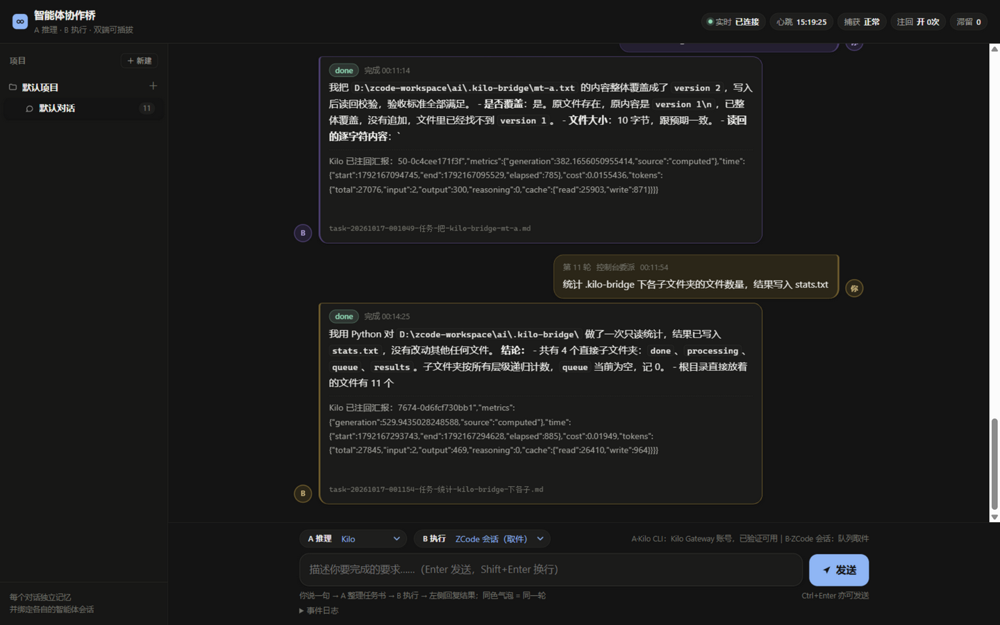
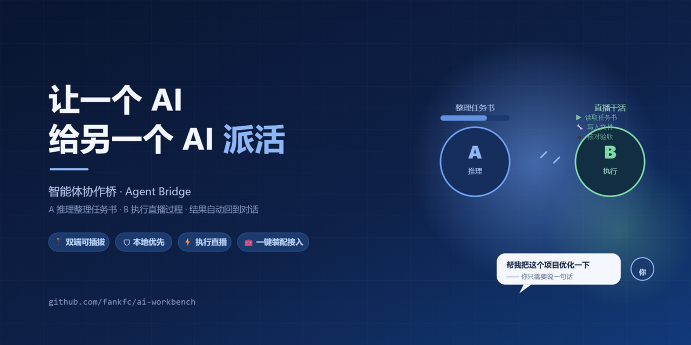
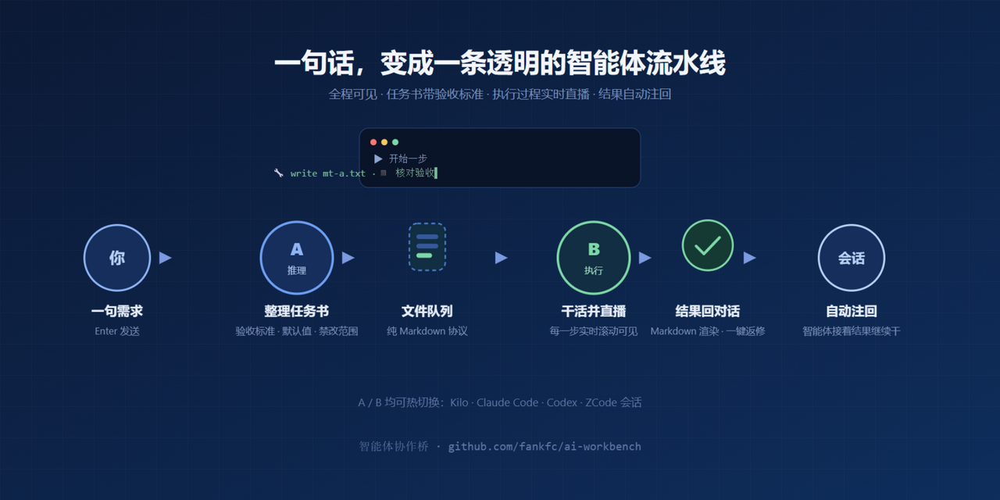
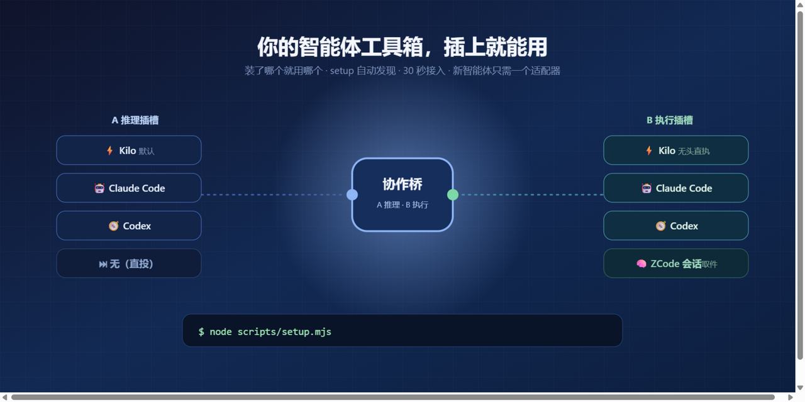
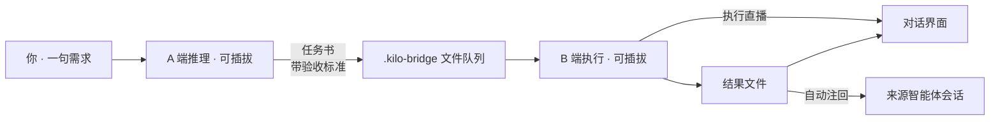
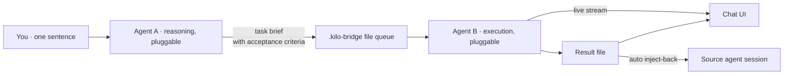

<div align="center">

# 智能体协作桥 · Agent Bridge

**让一个 AI 给另一个 AI 派活 —— A 推理 · B 执行 · 双端可插拔**

*Let one AI hand work to another — A reasons, B executes, both ends pluggable.*




<table><tr>
<td></td>
<td></td>
</tr><tr>
<td colspan="2" align="center"></td>
</tr></table>

**[🇨🇳 中文版](#中文版)** · **[🇬🇧 English](#english)**

</div>

---

## 中文版

想象一条小型流水线：你随口说一句需求，A 端智能体把它想清楚，写成一份带验收标准的任务书；B 端智能体接单开干，全过程像直播一样实时滚动；干完之后，结果自动送回对话——来源会话还能拿着这个结果继续往下干。

### ✨ 特性

- 🔌 **两端随时换** — A 端（出主意的）和 B 端（干活的）各自独立插拔：Kilo / Claude Code / Codex 无头直执，或 ZCode 会话取件模式，网页下拉一选即换
- 🗂 **项目与对话** — 左侧「项目 → 对话」两级收纳；每个对话有自己的多轮记忆，并始终绑定 A 端同一个会话——你说“把刚才那个文件改一下”，它真懂
- 📺 **执行直播** — B 端干活时，工具调用、步骤、文本片段都实时滚在气泡里，不用对着黑箱干等
- 🔁 **返修与注回** — 结果不满意？一键返修，带上上下文重新投递；满意就自动注回来源会话，智能体接着这个结果继续干活
- 🛡 **本地优先** — 只监听 127.0.0.1；协议就是几个纯 Markdown 任务书文件；不需要 API Key、不碰云端，你的订阅账号就是凭证
- 🧰 **一条命令装配** — `node scripts/setup.mjs` 把环境检测、智能体发现、自检（可选开机自启）全部办好
- 🌗 **顺手的对话界面** — 深浅双主题、安全的 Markdown 渲染、对中文输入法友好的 Enter 发送、回到最新、一键复制结果
- 🧪 **认真的工程** — 26 项单元测试、格式不符直接拒收、滞留自动告警、注回去重、断线自动降级轮询、守护自启

### 🚀 快速开始

```bash
git clone https://github.com/fankfc/ai-workbench.git && cd ai
node scripts/setup.mjs            # 环境检测 + 智能体发现 + 目录初始化 + 自检
# 可选：--kilo-rules 接入 Kilo 会话捕获；--autostart 开机自启；--start 装配后立即启动
npm run bridge-client             # 启动后打开 http://127.0.0.1:8791
```

要求：Node.js ≥ 22.5（建议 24）。本机装了 Kilo / Claude Code / Codex 任一 CLI 就会被自动发现并接入（也可以用环境变量 `KILO_BIN` / `CLAUDE_BIN` / `CODEX_BIN` 指定路径）。没发现的智能体自动跳过，不影响其余功能。

### 🧩 工作原理



### 🔌 智能体支持矩阵

| 智能体 | A 推理 | B 执行 | 说明 |
| --- | --- | --- | --- |
| **Kilo CLI** | ✅（默认） | ✅ 无头直执 | 支持会话续接与注回（Kilo Gateway 账号） |
| **Claude Code** | ✅ | ✅ 无头直执 | 需已登录；未登录时如实报认证错误 |
| **Codex CLI** | ✅ | ✅ 无头直执 | 沙箱内非交互执行，纯文本汇报 |
| **ZCode 会话** | — | ✅ 取件模式 | 编码计划账号；配合取件自动化使用 |
| **无（直投）** | ✅ | — | 需求不经推理，直接入队 |

想接入新智能体？在 `agentAdapters()` 里加一个 `{ path, argv, parseText, canContinue }` 描述就行。

### 🖥️ 界面

对话式双栏：你的话在右侧气泡，B 端结果在左侧（状态、Markdown 摘要、注回汇报一应俱全），同一轮对话同色标识，8 种淡雅配色轮换；顶部一排实时状态（连接 / 心跳 / 捕获 / 注回 / 滞留），底部是 A/B 角色选择与输入框。

### 📚 文档

- [智能体桥运行手册](docs/runbooks/kilo-bridge.md) — 部署、运维、故障排查
- [桥接协议 BRIDGE.md](.kilo-bridge/BRIDGE.md) — 任务/结果文件格式与目录状态机
- [D004/D005 复检报告](docs/acceptance/D004-D005-recheck-20261016.md) — 文件桥架构的由来（平台缺口分析）

### 🧪 质量与测试

```bash
npm run test:bridge-client   # 26 项单元测试（协议解析 / 适配器 / 线程隔离 / Markdown 安全渲染）
```

### 🏛 项目背景

这个仓库最初是一个 Windows 优先的本地桌面 AI 协作工作台（设计目标见 [DESIGN.md](DESIGN.md)），协作桥是在它的文件协议与工程规范之上长出来的。目前是个人自用定位：不发行、不分发、不做代码签名，安心跑在自己的机器上就好——但质量、多语言、崩溃恢复这些标准一点没松。

想了解来龙去脉？从阶段二到五的验收证据、冻结记录与回归基线都在 [docs/acceptance/](docs/acceptance/) 留档。桌面端照常可用：`npm run build:desktop` 后执行 `npm run desktop`，`npm run desktop:demo` 跑明确标记的模拟响应；后端恢复与桌面迁移见[后端运行手册](docs/runbooks/backend-operations.md)与[桌面运行手册](docs/runbooks/desktop-operations.md)。默认测试不碰真实外部模型，跑多少次都不产生模型调用费用。

---

## English

Picture a small assembly line for AI work. You type one sentence; Agent A thinks it over and turns it into a task brief with acceptance criteria; Agent B picks it up and gets to work — every tool call and step streaming live into your chat. When it's done, the result flows back into the conversation automatically, and the originating session can keep building on it.

### ✨ Features

- 🔌 **Pluggable on both ends** — the reasoner (A) and the executor (B) swap independently: run Kilo / Claude Code / Codex headless, or use ZCode in session-pickup mode. Pick from a dropdown in the web UI.
- 🗂 **Projects & threads** — a two-level project → thread layout on the left; each thread keeps its own multi-turn memory and stays bound to the same A-side session, so "tweak that file from earlier" just works.
- 📺 **Live execution** — while B works, tool calls, steps, and text stream into the chat bubble in real time. No more staring into a black box.
- 🔁 **Rework & inject-back** — not happy with a result? Send it back for rework with full context in one click. Happy? It's automatically injected into the source session, and the agent carries on from there.
- 🛡 **Local-first** — listens on 127.0.0.1 only; the protocol is plain Markdown task files; no API keys, no cloud. Your existing subscription is the credential.
- 🧰 **One-command setup** — `node scripts/setup.mjs` handles environment checks, agent discovery, self-checks, and optionally auto-start on boot.
- 🌗 **A pleasant chat UI** — dark & light themes, safe Markdown rendering, IME-friendly Enter-to-send, jump-to-latest, one-click result copy.
- 🧪 **Seriously engineered** — 26 unit tests, strict format validation (malformed tasks are rejected), stall alerts, inject-back deduplication, automatic polling fallback on disconnect, watchdog auto-start.

### 🚀 Quick start

```bash
git clone https://github.com/fankfc/ai-workbench.git && cd ai
node scripts/setup.mjs            # env check + agent discovery + init + self-test
# optional: --kilo-rules (Kilo session capture) / --autostart / --start
npm run bridge-client             # then open http://127.0.0.1:8791
```

Requirements: Node.js ≥ 22.5 (24 recommended). Any of the Kilo / Claude Code / Codex CLIs installed locally is auto-discovered and wired in (the `KILO_BIN` / `CLAUDE_BIN` / `CODEX_BIN` environment variables work too). Agents that aren't found are simply skipped — nothing else breaks.

### 🧩 How it works



### 🔌 Agent support matrix

| Agent | A (reason) | B (execute) | Notes |
| --- | --- | --- | --- |
| **Kilo CLI** | ✅ (default) | ✅ headless | Session continuation & inject-back (Kilo Gateway account) |
| **Claude Code** | ✅ | ✅ headless | Requires login; auth errors are reported honestly |
| **Codex CLI** | ✅ | ✅ headless | Non-interactive in a sandbox, plain-text reports |
| **ZCode session** | — | ✅ pickup mode | Coding-plan account; pairs with pickup automation |
| **None (direct)** | ✅ | — | Requirement enters the queue without reasoning |

Adding a new agent is just a `{ path, argv, parseText, canContinue }` descriptor in `agentAdapters()`.

### 🖥️ The UI

A two-column chat: your messages on the right, B-side results on the left (status, Markdown summary, inject-back report). Each turn gets its own color from a rotation of 8 soft palettes. A real-time status bar sits on top (connection / heartbeat / capture / inject-back / stalls), with A/B role pickers and the input box at the bottom.

### 📚 Documentation

- [Bridge runbook](docs/runbooks/kilo-bridge.md) — deployment, operations, troubleshooting
- [Bridge protocol BRIDGE.md](.kilo-bridge/BRIDGE.md) — task/result file formats and the directory state machine
- [D004/D005 recheck report](docs/acceptance/D004-D005-recheck-20261016.md) — why a file-based bridge (platform gap analysis)

### 🧪 Quality & tests

```bash
npm run test:bridge-client   # 26 unit tests (protocol parsing / adapters / thread isolation / safe Markdown rendering)
```

### 🏛 Background

This repo started life as a Windows-first local desktop AI workbench (design goals in [DESIGN.md](DESIGN.md)); the bridge grew out of its file protocol and engineering conventions. Today it's a personal-use project: not distributed, not signed — it just runs on your own machine — while quality, i18n, and crash-recovery standards stay exactly as strict.

Acceptance evidence, freeze records, and regression baselines from phases two through five are archived under [docs/acceptance/](docs/acceptance/). The desktop app still works: run `npm run build:desktop`, then `npm run desktop` (`npm run desktop:demo` uses clearly-labeled mock responses). Backend recovery and desktop migration are covered in the [backend runbook](docs/runbooks/backend-operations.md) and [desktop runbook](docs/runbooks/desktop-operations.md). The default test suite never calls real external models, so running it costs nothing.
