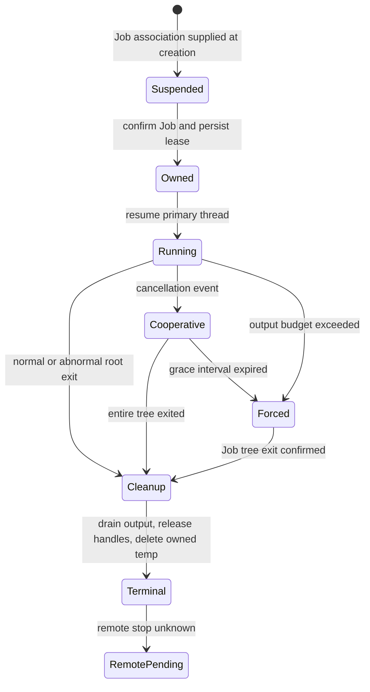

# D011 implementation record

Status: implemented; Windows fixture verification passed. No model calls.

Test-first evidence: the importable ProcessManager stub raised
`PROCESS_LIFECYCLE_NOT_IMPLEMENTED`; ResourceLimits lacked validation. The initial
Windows-only fixture suite produced 13 behavior failures (not collection errors).

The repeatable command is
`services/orchestrator/.venv/Scripts/python.exe -m pytest tests/integration/test_process_lifecycle.py -m windows -q`.
It passed 23 tests on Windows with exit 0. The acceptance runner
`services/orchestrator/.venv/Scripts/python.exe docs/acceptance/D011/verify.py`
passed five process scenarios and five resource scenarios with exit 0.
`process-tree.json` and `resource-report.json` contain actual PIDs, parent IDs,
results, lease records, budgets and source SHA-256 hashes. `red.txt` and
`remote-confirmation-red.txt` preserve effective pre-implementation counterexamples.

The manager starts native executables with an argument array (Windows argv
quoting; no shell). Only a small environment allowlist is copied; model tokens,
home/profile and arbitrary credentials are absent. A fixed existing directory
is exclusive to each active attempt. TEMP/TMP point to an owned directory.
The manager starts the primary thread suspended with Job membership supplied at
creation, persists the PID association, and only then resumes it. Windows 10+
PROC_THREAD_ATTRIBUTE_JOB_LIST avoids a separate CreateProcess-to-assign window;
the Job membership is checked before resume.

The Job uses KILL_ON_JOB_CLOSE and an active process cap. The only inherited
handles are stdin/stdout/stderr, selected through the startup handle list.
The event, Job and process ownership handles are not inherited. The cancellation
event gives cooperating executors a bounded exit opportunity; ignored events
lead to TerminateJobObject. Parent completion also reclaims live descendants.
Forced termination of the owner service was tested and left no live worker,
child or grandchild. This follows documented
[Job ownership semantics](https://learn.microsoft.com/en-us/windows/win32/procthread/job-objects)
and [suspended process creation](https://learn.microsoft.com/en-us/windows/win32/procthread/process-creation-flags).
The regression fixture deliberately exits the owner immediately after
CreateProcessW returns, before normal startup bookkeeping. Its suspended child
is reclaimed through Job close and never executes the worker entry point.
The same case failed before adopting the
[process creation Job list](https://learn.microsoft.com/en-us/windows/win32/api/processthreadsapi/nf-processthreadsapi-updateprocthreadattribute);
`create-race-red.txt` preserves that effective counterexample.

The stdout/stderr reader threads consume fixed chunks into a shared byte cap,
rather than capturing unlimited output first. Excess kills the Job and returns
resource_limit. Running attempts, temp-directory count and native handle
reservation are checked before launch. Normal and abnormal completion, invalid
PE startup rollback, close, duplicate attempt rejection, cross-handle ownership,
remote confirmation type, persistent ledger reopen, malicious shell-looking
arguments and credential isolation are covered. Ten repeated launches also
check the real OS process handle count, not merely an internal counter.

The process-cap fixture admitted exactly the parent and two child workers and
rejected six additional starts with WinError 1816. Windows Job accounting can
retain a rejected terminated process until all external OS references disappear;
the acceptance report therefore distinguishes Job accounting from workers that
actually entered Python and wrote heartbeats. This is documented in
[JOBOBJECT_BASIC_ACCOUNTING_INFORMATION](https://learn.microsoft.com/en-us/windows/win32/api/winnt/ns-winnt-jobobject_basic_accounting_information).

Local cancellation and remote stop are separate. Unknown remote execution IDs
remain unknown in the ledger, and the result says cancel_pending_remote.
Only explicit consumer confirmation changes a remote state to stopped.
The compatible optional step_id identifies each executor invocation inside an
attempt. Two sequential B/A steps retain distinct durable lease records; a
completed invocation cannot be silently rerun. Every remote unknown invocation
blocks new steps until explicit confirmation, including normal local exit and
forced owner death with an abandoned running lease. The private legacy
ledger is migrated by retaining its original records as the default step;
the shared D008 schema is unchanged. step-key-red.txt contains the pre-change
counterexample.

The final acceptance run exposed a fixture startup-order timeout, preserved in
acceptance-before-trigger.txt. A fixed 0.3-second parent lifetime can race worker
startup under load; five subsequent observations in parent-exit-timing.json did
not reproduce it. The parent-normal-exit fixture now waits for an explicit test
trigger after all three worker records exist, then returns normally. This keeps
the live-descendant cleanup condition deterministic without changing lifecycle code.

Independent review reproduced remote-unknown bypasses and an accounting-query
failure. Historical remote confirmation is explicit and boolean; no local exit
or service restart implies remote stop. A Job-query failure now still closes the
Job and native handles, safely removes the owned temp, and persists cleanup_failed.
Resource snapshots retain the failed-cleanup count and report unknown accounting
as None. The review's before/after evidence is retained in the shared
remaining-process-scope-evidence records; the fresh combined 64-test scope suite
also verifies these failures and the D017 immutable-span boundary.

The module controls lifecycle and native resources. It does not enforce a
filesystem OS sandbox, impose child application handle quotas, or authenticate
providers. Executors that do not support the named cancellation event receive
the same bounded forced Job cleanup. Abrupt service death leaves the owned temp
directory for D012 recovery; the private ledger preserves its exact path and
remote ID. Tests and evidence runners remove only their own temporary roots.

No installation, shared database schema changes, or commits were made.

