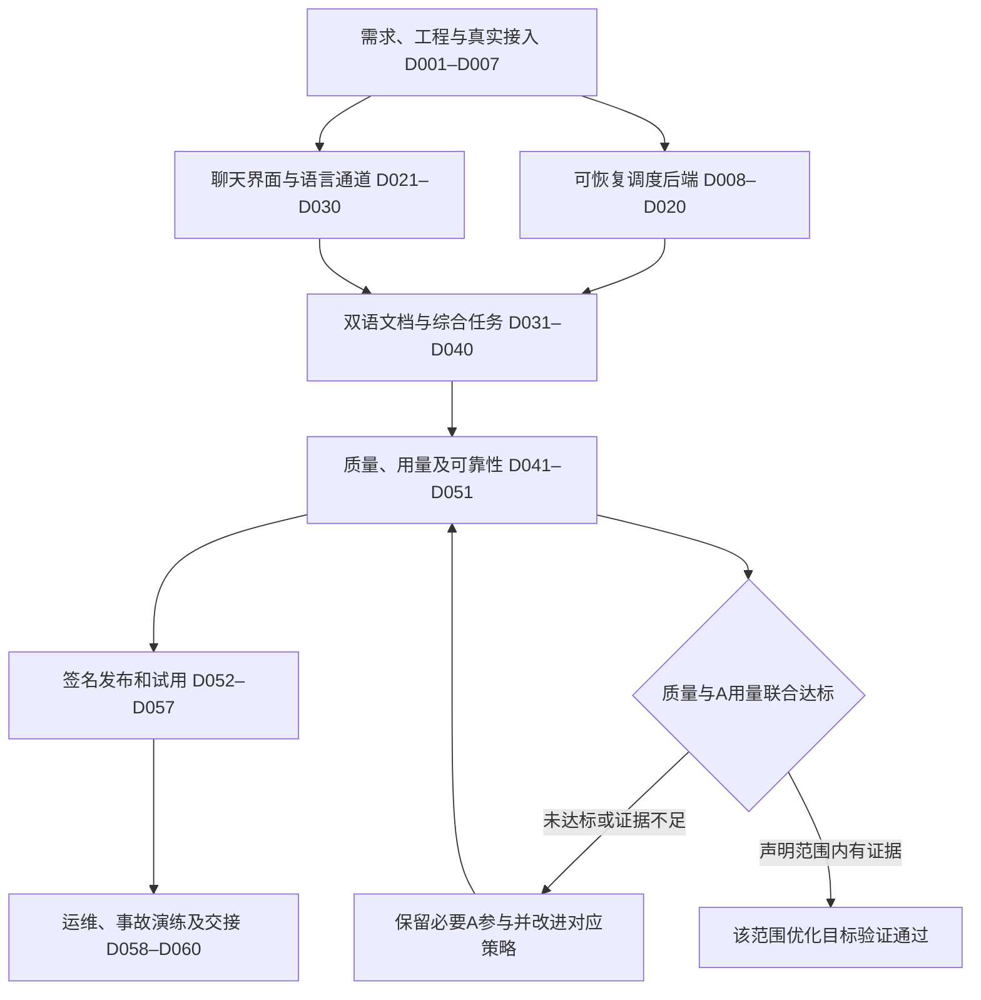

# 双模型工作台：从需求到工业化终验的执行总纲

> **For agentic workers:** REQUIRED SUB-SKILL: Use superpowers:subagent-driven-development (recommended) or superpowers:executing-plans to implement this plan task-by-task. Steps use checkbox (`- [ ]`) syntax for tracking. 使用当前环境实际提供的对应技能，不依赖不存在的工具。

**Goal:** 将 Claude 主导、ZCode/GLM 执行的综合任务系统开发成可安装、可恢复、可验证的聊天式桌面软件，并逐项验证 A 的质量基准、A token 节省、Claude 专用双向翻译及双语文档交付要求。

**Architecture:** Electron/React 客户端只消费公开问答与文件事件；Python 本地服务管理持久任务、适配器、翻译、验证、版本和发布。A 决定核心推理与质量，B 执行和翻译，普通程序保证交接和检查可重复。

**Tech Stack:** Electron、React、TypeScript、Python、FastAPI、Pydantic、SQLite、pytest、Playwright；文档处理器以本机能力验证和版本锁定为准。

日期：2026-10-13（Asia/Shanghai）。本包是计划交付，全部开发任务初始状态为 `planned`；文档完成不代表软件已实现或测试通过。

## Global Constraints

- A 主要为 Claude Code 中的 Claude，GPT 是可选 A；B 使用 ZCode 中的 GLM。
- 质量以 A 独立完成任务的表现为基准，减少 A 总 token，不能通过降低质量或遗漏任务来制造节省。
- Claude 中文输入完整英译，A 英文回答完整中译；GPT 不强制翻译。
- 主聊天仅显示用户问题、必要澄清、最终回答和文件，不显示内部翻译及代理流程。
- Claude 的 PDF、DOCX、MD 文档交付完整 A 英文定稿和 B 中文译文；真实来源、内容及版本可追溯。
- A 必须实际输出最终采用的完整英文正文；B 写作、A 仅 PASS 不满足 A 原文要求。
- 所有运行失败、重试、返修、接管及翻译消耗均计入用量，未知用量不记为零。
- 模型身份、CLI 功能、会话复用和账号可用性必须实测，不以配置成功代替真实连接。
- 翻译不改变服务商的地区与账户资格；不修改或绕过现有权限控制。
- 首版范围为 Windows 11 x64 单用户本地软件；正式发布有签名、备份、恢复与更新回滚能力。
- 运行中的 A 身份和语言策略按轮次冻结；切换只影响下一轮，接管当前任务需新版本。
- 本文件中的命令、测试和预期行为用于未来实施，没有在本次计划编写中运行产品或调用用户模型。

---

## 1. 如何使用这套手册

按以下顺序阅读和执行，不必每次把全部文档发送给 A：

1. 本总纲：理解目标、角色、阶段门槛、任务状态和执行规则。
2. [D001–D020：工程基础、接入与调度](01-foundation-runtime.md)。
3. [D021–D040：界面、翻译与文档](02-ui-translation-documents.md)。
4. [D041–D060：验收、发布与运行维护](03-verification-release-operations.md)。
5. [软件运行时完整操作流程](04-runtime-sop.md)：用于集成、用户验收和运行故障定位。
6. [任务派发、提示词和评审模板](05-work-orders-and-prompts.md)：用于把任务发给开发者或 AI 执行者。
7. [60 项任务索引](TASK-INDEX.md)与[机器可读任务板](task-board.json)：任务、依赖、证据和状态；实施者更新状态时不能跳过验收。

需要连续阅读时打开[完整逐项手册](FULL-MANUAL.md)。它合并上述六个章节，任务卡内容完整保留；修订应先改分卷，再重新汇总。

完整软件需求继续参考 [主开发计划](../2026-10-13-industrial-agent-workbench-plan.md)、[界面合同](../../../../DESIGN.md)、[翻译交付规格](../../specs/2026-10-13-translation-delivery-spec.md)和[质量发布规格](../2026-10-13-quality-release-plan.md)。本包细化操作顺序和任务粒度；不得用细化过程降低已有需求。

## 2. 明确区分三种完成状态

| 状态 | 含义 | 不能据此宣称 |
| --- | --- | --- |
| PLAN_READY | 需求、任务、接口、测试和交付标准明确 | 软件已能使用 |
| FUNCTIONAL_READY | 指定版本的真实连接、GUI、翻译、文档、恢复和安装验收通过 | 所有任务都具备 A 的同等能力且节省 token |
| GOAL_VALIDATED | 在声明的任务领域、难度、模型与配置范围内，质量和 A 用量联合门槛通过 | 未测领域也同样有效 |

当前只完成计划。软件即使采用 A 主导的保守配置达到 FUNCTIONAL_READY，也不能把尚未验证的 token 优化目标标记为完成。

没有证据支持质量或节省时，报告其真实状态并继续对应改进任务。不能用“工业化软件已经上线”替代用户最初的质量与成本目标。

## 3. 责任分配

| 角色 | 主要责任 | 交接要求 |
| --- | --- | --- |
| 产品/用户代表 | 需求边界、典型任务和最终体验验收 | 明确变更内容及影响，不要求每项技术操作反复审批 |
| 架构与 A 策略负责人 | 接口、质量判断、升级与 token 策略 | 输出简短决策、约束和验收依据 |
| 后端工程师 | 适配器、调度、存储、语言与文件服务 | 可运行切片及真实验证证据 |
| 客户端工程师 | Electron、聊天页面、设置、预览与桌面交付 | 截图、交互及无障碍测试 |
| QA/双语/领域评审 | 反例、真实任务、翻译和基准评价 | 可追踪样本、缺陷及复验结论 |
| 发布运维负责人 | 包签名、迁移、备份、回滚和事故处理 | 发布清单、恢复演练与运行手册 |

小团队可兼任，但执行者自报完成不能代替证据复核。开发使用 AI 时，将 A 用于架构和关键评审，B 按单个任务卡执行；不同工作单明确文件范围，避免并行覆盖。

## 4. 开始执行前的固定准备

- [ ] 从 D001 核对 R01–R15，记录本次版本明确支持的任务和文件格式。
- [ ] 确认工作目录及已有文件，保存用户现有改动；需要隔离时建立有明确基线的工作区。
- [ ] 执行 D002 的工程准备后，才运行依赖该工程的测试命令。
- [ ] D003 只读检测工具、版本和路径，不把检测结果当作账号或模型可用证明。
- [ ] D004–D006 用小任务验证真实接入，保存请求、结果及模型身份依据。
- [ ] GPT 尚未配置时界面显示未连接，可继续默认 Claude 路径开发；GPT 发布范围需真实验证通过。
- [ ] 按 D007 冻结公共协议，再启动依赖它的客户端和其他工作包。
- [ ] 启用本地工作区、日志脱敏、任务隔离和取消机制后，再开展较长真实模型任务。

本手册修正早期概览中“先运行完整适配测试、后建立测试工程”的顺序：先有可运行的最小测试工程，再开展可重复接入实验。小型能力探测与正式适配器合同分开记录，随后统一到 D007。

## 5. 任务状态与证据规则

开发任务采用 `planned → ready → in_progress → in_review → done`。失败或依赖缺失进入 `blocked`；取消进入 `cancelled`。这些是开发任务板状态，不等于产品内部运行状态。

转换条件：

| 转换 | 必须具备 |
| --- | --- |
| planned → ready | 依赖完成，输入文件可读，合同版本一致 |
| ready → in_progress | 执行者和文件范围明确，验证方法可用 |
| in_progress → in_review | 所有操作步骤完成，测试和产物证据已保存 |
| in_review → done | 复核无阻断缺陷，正例/负例结果符合要求 |
| 任意状态 → blocked | 明确阻塞事实、已尝试动作、缺少条件、可继续的独立任务 |
| blocked → ready | 阻塞解除的证据已保存，重新核对依赖版本 |

任务实现完成但真实接入未测，应保持相应任务或阶段未完成；模拟结果可以验证软件逻辑，不替代真实连接证明。

每张卡的证据目录应包含：环境与版本、输入/样本标识、实际命令、退出码或结果、成果哈希、失败记录、修复差异和复核结论。日志不包含凭证，正文按最小必要范围保存。

开发任务的 `done` 仅表示该卡目标达成。D020 后端通过不代表 GUI/翻译通过；D040 功能贯通不代表工业化发布和成本目标通过。

## 6. 每个任务的执行节奏

1. 读取任务卡、直接依赖的交付物及适用合同；不无差别加载全部项目历史。
2. 核对允许修改的文件，确认不存在其他执行者同时写入。
3. 建立一个能够暴露该行为缺失或错误的测试/检查。
4. 在未实现行为时运行，确认失败原因与目标相关；缺依赖、拼错路径不算有效业务反例。
5. 按任务卡逐项实现；发现需要改变公共合同，先记录变更与受影响任务。
6. 运行任务指定检查；出现失败先定位原因，不盲目扩大重写范围。
7. 检查负例、取消或恢复路径，核对实际成果而不是只读执行报告。
8. 保存证据、差异、已知限制和用量；让复核者作通过或返修判断。
9. 复核通过后提交相关文件，更新任务板；提交范围不夹带用户无关改动。
10. 从依赖已满足的任务中选择下一项。无关文案和低风险可逆修改无需机械地添加测试。

任务卡中的动作采用复选框，一次勾选一个可验证动作。单次工程动作目标为数分钟；真实模型执行、文档渲染、基准评审可能更久，等待不算完成证据。

## 7. 依赖和并行安排

依赖以 `task-board.json` 的 `requires` 为准，编号只提供总体推进方向。不要因为编号相邻就默认前一任务是唯一依赖。

可并行的典型工作：

- D007 协议稳定后，后端状态与客户端布局可以由不同人推进。
- 翻译协议稳定后，输入翻译、输出翻译和文档块模型可在独立文件范围内开发。
- 真实模型集成与 fake 故障测试可以并行；两个结果分别记录。
- 功能稳定后，双语评测、界面可访问性与安装升级验证可以并行。

必须串行的关键交接：模型身份确认→语言路由；A 英文定稿→译文；全部文件验证→配对发布；上游变更→下游重验；包构建→签名→签名验证→分发。

对共享协议、数据库迁移和发布清单安排单一写入负责人。需要并行修改代码时，使用独立分支/工作区和明确合并点；不得把两个未经整合的分支测试结果拼成最终通过。

## 8. 七个阶段的退出门槛

此图表示整体交接，不代替逐任务依赖。G5/G6 的功能交付结论和 Q 的优化结论分别保留。

| 阶段 | 对应任务 | 退出时必须提供 |
| --- | --- | --- |
| G0 需求与接入事实 | D001–D007 | 需求基线、工程锁文件、真实模型与接口能力、统一协议 |
| G1 可恢复后端 | D008–D020 | 持久任务、A/B执行、去重取消、用量与隔离、后端切片报告 |
| G2 聊天与语言闭环 | D021–D030 | 实际界面、完整双向翻译、GPT直通、公共事件不泄漏 |
| G3 文件与综合任务 | D031–D040 | A原文证据、三种格式、双语配对、依赖失效及真实贯通 |
| G4 质量和可靠性 | D041–D051 | 回归、双语、人评基准、真实用量、故障恢复和备份报告 |
| G5 可交付版本 | D052–D057 | 签名安装/更新回滚、CI与供应链清单、试用和发布决定 |
| G6 运维与终验 | D058–D060 | 运行规程、事故演练、用户手册、维护责任与目标达成范围 |

阶段门槛是工程质量检查，不是要求用户逐个批准普通操作。只有涉及用户偏好、实际授权缺口或无法推断的信息，才提出具体问题。

## 9. R01–R15 的终验口径

| 需求 | 终验时应回答的问题 |
| --- | --- |
| R01 | 指定任务类型的实际质量与 A 独立基线相比如何？哪些范围有足够证据？ |
| R02 | 包括失败和复核后，A 每个合格交付的总 token 是否下降？ |
| R03 | Claude/GPT 的实际身份与页面选择一致吗？未配置连接是否准确显示？ |
| R04 | B 是否真实由 ZCode 的 GLM 执行，结果和恢复是否可追踪？ |
| R05 | 四类任务是否各有真实用户流程与正确成果？ |
| R06 | 安装后能通过图形界面独立完成任务吗？ |
| R07 | Claude 每次中文输入、纠正和追问是否完整英译？ |
| R08 | 最终中文回答是否完整保留 A 英文语义？ |
| R09 | A 原件来源是否真实，双语是否同版本且完整可打开？ |
| R10 | GPT 路径是否完全跳过非用户请求的翻译调用？ |
| R11 | 任何瞬间、回放、错误或重连中是否泄漏内部消息？ |
| R12 | 断电、取消、重复结果、未知远端状态是否正确处理？ |
| R13 | 安装、升级、迁移、备份、恢复和回滚是否实际演练？ |
| R14 | 用量可核对吗？缺失、缓存、累计与重试是否正确统计？ |
| R15 | 关键误译被拦截吗？歧义、OCR错误和截断是否如实处理？ |

评测量表、置信方法、样本量与例外必须在看结果之前冻结。人类评审分歧要裁决，不能让 A 自评分作为唯一质量证据。

## 10. 变更、缺陷和风险处理

变更记录至少包含：需求编号、提出原因、旧行为、新行为、影响文件、受影响任务、数据迁移需要、复验范围和负责人。已完成卡因合同改变失效时，创建变更工作单并重新进入复验，不偷偷保留旧通过状态。

缺陷分级：

- 阻断：数据丢失、跨会话读写、凭证泄漏、误报成功、错误双语配对、原件来源造假、关键需求/否定/数字误译。
- 重大：核心任务无法完成、模型身份路由错误、不能恢复、主要文件不可打开、关键交互不可用。
- 一般：不改变含义的文案、局部布局或次要操作问题。

阻断和重大缺陷修复并复验前不得批准相应功能发布。一般缺陷可按影响决定是否进入后续版本，必须记录，不能用于掩盖质量基准下降。

已识别风险及应对：

| 风险 | 首次检查 | 应对动作 |
| --- | --- | --- |
| ZCode当前版本无合适自动入口 | D003/D005 | 记录真实能力，评估受支持路线；停止全自动发布声明 |
| B翻译改变任务或结论 | D027–D030/D043 | 结构保护、语义复核、失败停止、必要澄清 |
| A完整文档输出使节省有限 | D031/D044–D046 | 保留必要成本，按领域报告，不伪造来源 |
| 本地超时但外部任务仍运行 | D011/D012/D048 | 对账、保存未知状态、避免重复派发 |
| 双语版面破坏 | D032–D036 | 块模型、字体和渲染检查，保留原件 |
| 模型或App升级行为改变 | D004–D007/D059 | 版本能力重验，暂停受影响优化配置 |
| 评估集被用于提示调参 | D043/D044 | 冻结holdout，独立保管，保留样本使用记录 |

## 11. 时间安排与每日推进

之前的 12–14 周估算以两名工程师、一名 QA 和按需领域评审为前提。任务板提供单任务工程小时估算，均需在实际接口和团队确定后校准。不能把所有小时简单相加当作日历工期，也不能承诺由 AI 执行就按固定比例缩短。

以下是初始排期模板。以真实依赖与退出门槛为准；上一阶段未过时，后续独立工作可继续，依赖它的发布结论不可提前。

| 周次 | 主要任务 | 当周应能拿出的成果 |
| --- | --- | --- |
| 第1周 | D001–D007 | 需求冻结、可重建工程、接入事实与协议；不可用入口明确列出 |
| 第2周 | D008–D012；D021–D023可并行部分 | 持久任务与恢复核心、可启动桌面与基础聊天 |
| 第3周 | D013–D020；D024–D025 | 后端真实切片、A/B闭环、模型设置及公开聊天边界 |
| 第4周 | D026–D030 | Claude完整双向翻译与GPT直通，翻译失败不会错发 |
| 第5周 | D031–D035 | A原件证明、三格式两语渲染、同版本原子发布 |
| 第6周 | D036–D040 | 文件预览保存、设置、四域配置及完整功能演示 |
| 第7周 | D041–D043；D047–D049 | 系统回归、翻译评测、隔离/故障/GUI缺陷清单 |
| 第8周 | D044–D045 | 质量基准冻结、正式样本方案和真实用量核对 |
| 第9周 | D046；D050–D051 | 分领域质量/token判定、持续运行及实际备份恢复 |
| 第10周 | D052–D054 | 签名安装、更新回滚、候选构建和供应链清单 |
| 第11周 | D055–D056 | 真实客户旅程、试用反馈、关键缺陷关闭证据 |
| 第12周 | D057–D060 | 发布决定、运维演练、终验与交接 |
| 第13–14周 | 基于实际缺陷安排缓冲 | 复验、接口变更及人工评审；不用于降低验收标准 |

D043/D044 的评审和正式样本执行可能成为关键路径，应在工程早期预约评审资源。账号接入、ZCode自动能力、签名条件或统计证据不足会改变日历工期，应及时修订排期及范围事实。

每日开始：核对依赖已完成任务、阻塞项及当日文件所有权。每日结束：更新完成动作、失败证据、下一步和用量，不写无依据的完成百分比。

每周检查：真实垂直切片是否可演示；新增缺陷和旧缺陷复发；是否出现新接口风险；翻译和质量是否回归；各阶段门槛是否需要重排。排期变更不改变验收标准。

## 12. 最终交接包

- 签名安装包、版本号、SHA-256、发布者与验证记录。
- 用户安装、连接、使用、文件导出、停止恢复和备份说明。
- 运维手册、事故处理、更新回滚、迁移恢复记录。
- R01–R15 需求覆盖、全部任务状态、测试环境与原始证据索引。
- 真实连接能力矩阵、支持文件类型、已验证模型与工具版本。
- A质量及token联合评测报告，区分已证明、证据不足和未测范围。
- 已知限制、一般缺陷、后续维护责任和依赖更新规则。

接收人按 D060 实际安装并完成代表性任务，核实文件和备份可用后交接。没有完成证据的条目保持未完成，不以文档篇幅或演示截图替代。
