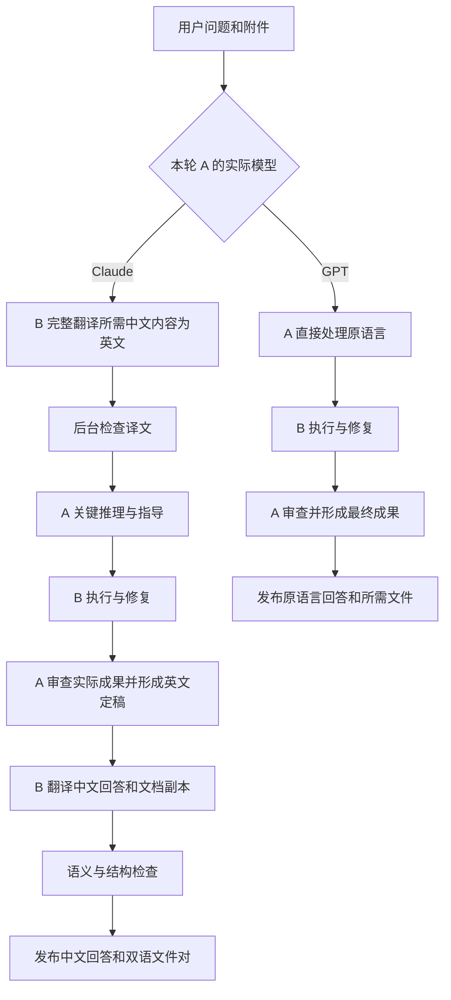

# 双模型工作台工业化软件完成计划

> **For agentic workers:** REQUIRED SUB-SKILL: Use superpowers:subagent-driven-development (recommended) or superpowers:executing-plans to implement this plan task-by-task. Steps use checkbox (`- [ ]`) syntax for tracking. 本文是总计划，执行时采用当前环境提供的对应技能与原生协作工具。

**Goal:** 构建 Windows 优先的聊天式桌面软件，以 Claude Code 中的 Claude 为主要高级智能体 A、ZCode 中的 GLM 为执行智能体 B，在保持 A 独立完成任务的质量基准的目标下减少 A 总 token，并按 A 的实际模型类型自动完成后台语言转换和双语文件交付。

**Architecture:** Electron + React 提供聊天界面，Python 本地服务负责持久化调度、适配器、翻译质量检查和文档交付。内部执行事件与用户消息使用不同的数据通道。Claude 走中→英→A 工作→英→中路径，GPT 直接使用用户语言，B 的执行职责在两种路径下都保留。

**Tech Stack:** Electron、React、TypeScript、Vite；Python、FastAPI、Pydantic、SQLite；pytest、Playwright；文档解析、渲染与 OCR 工具按能力检测装配，具体版本在 P0 锁定并记录依赖清单。

日期：2026-10-13（Asia/Shanghai）  
交付状态：开发计划与设计合同。尚未实现、安装、连接模型或验证本机的端到端运行。

详细实施顺序现已展开为 [60 项任务执行总纲](2026-10-13-execution/00-execution-guide.md)及[完整逐项手册](2026-10-13-execution/FULL-MANUAL.md)。实施时依任务板检查前置条件，先建立工程与测试环境，再运行依赖它的接入测试；本主计划继续作为总体需求与架构依据。

## Global Constraints

- 质量目标是保持 A 单独完成同类任务时的智能表现与交付水平；在此条件下尽量减少 A 的总 token 消耗。
- A 主要使用 Claude Code 中的 Claude；GPT 为用户可选替换，不在后台擅自切换。
- B 使用用户现有 ZCode 中的 GLM；翻译、自查和任务执行使用隔离的任务上下文。
- Claude 输入完整翻译为英文，最终英文回答完整翻译为中文；翻译不可替代为摘要。
- GPT 分支不执行强制翻译，不强制增加双语副本。
- 主聊天仅展示用户问题、最终回答和交付文件；内部翻译、调度、模型往返和验证日志不进入聊天消息通道。
- Claude 文档交付包含 A 原文版本及 B 中文译文；两份文件必须对应同一版本。
- 由 B 写作、A 仅审核的文件，不得标记为 A 生成的原文。
- 默认不展示未经翻译检查的 Claude 英文回答，不能先流式显示英文再替换成中文。
- 不承诺绝对零翻译错误、所有任务同等智能或固定 token 节省比例；以定义清楚的验收和实测作为依据。
- 翻译是语言功能，不改变服务商支持地区、账户或实体资格；接入需要正常可用的服务权限。
- 现有 ZCode 桌面会话、CLI 会话、登录和额度是否互通，以 P0 实测结果为准。
- 第一版以 Windows 11 x64 单用户本地桌面为交付范围；历史可离线查看，模型任务需要连接服务。

---

## 1. 产品目标与需求编号

用户希望用一个类似常见 GPT 聊天页的软件，处理编程、论文、文档及综合任务。页面保持简单，后台由 A 作关键判断、B 承担执行和语言处理、C 管理流程。

| 编号 | 硬性需求 | 完成证据 |
| --- | --- | --- |
| R01 | 以 A 独立完成任务的质量为基准 | 分领域配对评估与重大缺陷记录 |
| R02 | 尽量减少 A 总 token | 含失败、重试、复核的真实用量账本 |
| R03 | Claude 主用、GPT 可选 | 实际模型识别与分支路由契约测试 |
| R04 | 使用 ZCode 中的 GLM | 真实启动、执行、完成与恢复接入报告 |
| R05 | 编程、论文、文档及综合任务 | 每种类型的真实交付样例 |
| R06 | 聊天式图形界面 | 桌面端键盘、鼠标、附件与历史端到端测试 |
| R07 | Claude 前置完整中→英翻译 | 输入译文、原文对应关系及语义验证 |
| R08 | Claude 最终回答英→中 | 只发布检查后的中文回答 |
| R09 | 双语文档及真实 A 原文来源 | 原件哈希、生成记录、译文来源版本与配对发布记录 |
| R10 | GPT 无强制翻译 | translator 调用次数为零的契约断言 |
| R11 | 主聊天隐藏内部过程 | 公共事件白名单与 UI 泄漏测试 |
| R12 | 中断恢复、去重、取消、隔离 | 故障注入与恢复测试 |
| R13 | 安全安装、更新、迁移、备份 | 签名、安装/升级/回滚与恢复演练 |
| R14 | 可核对用量和运行记录 | 请求级去重，累计计数正确归一化 |
| R15 | 翻译忠实、歧义可处理 | 双向翻译样本库及人工双语复核 |

第一版不建设云端多租户、组织计费或移动客户端。接口保留扩展能力，先交付本机长期可用的完整产品。

## 2. 用户看到的产品

主界面按 DESIGN.md 实施：左侧会话历史，中间问答，底部附件与输入框；顶部可选择 Claude/GPT。当前任务执行时固定 A 的实际模型类型，切换只影响后续任务。

Claude 示例：用户看到中文提问和最终中文回答。文件卡显示“英文原文 / 中文译文 / 下载全部”，不显示翻译步骤、B 的报告或 A/B 对话。

GPT 示例：用户按原语言提问并收到对应回答；文件按任务要求交付，无自动双语化。

等待期间使用普通生成指示和停止按钮，不展示后台阶段。需要用户补充关键信息时，以中文问题出现；失败时给出简短中文说明和可执行恢复动作，不能为了隐藏流程而伪装成功。

设置页面独立管理模型连接、工作目录、预算、语言术语表、备份和用量；诊断导出不混入聊天。

## 3. 条件语言路径



图仅用于开发文档。实际聊天页不显示该图，也不显示图中的内部阶段。

语言路由依据经适配器确认的 model_family，不依据 App 名、用户昵称或模型配置别名。无法确认模型族时阻止启动并要求修正连接，不能猜测分支。

Claude 的追问、补充要求和必要历史上下文同样经过语言策略。代码、路径、公式、DOI、标识符和必须保留的原文引文作为受保护片段保留；英文工作语言不等于删除一切中文字符。

缓存仅复用同源内容、方向、术语表版本、翻译策略和模型版本下的检查通过译文。原件改变后不得沿用旧译文。

## 4. 质量与成本的边界

A 承担问题建模、核心推理、方法/架构/论证选择、关键证据判断与最后验收。B 承担检索整理、实现、计算、草稿展开、格式处理、翻译和明确缺陷修复。

按任务选择常规执行、关键节点指导或 A 主导困难部分。两次参与只是简单任务路径，不能作为固定上限。

若用户要求 A 亲自产出的完整英文原文，A 的必要输出成本保留。可以节省其资料搬运、重复阅读和返工，不能用“B 写完、A 点通过”冒充 A 原文来制造节省数字。

翻译岗位与执行岗位在 B 中隔离上下文：译者不得修改事实、替用户补充需求或把不确定表述改成确定结论。完整翻译与上下文摘要分别存储、分别标记；摘要用于定位，A 必须能取回完整的相关英文材料。

翻译检查由程序保护项校验、B 独立上下文复核与开发期双语人工评测组成。回译和同模型自检只能提供辅助信号，不能证明完全等义。

若源文存在影响执行的歧义，保留歧义并提出必要澄清；不自动编造一个“无歧义版本”。正文、否定、数量、单位、限定条件、语气和不确定性均属于翻译质量要求。

## 5. 模块与运行边界

```text
Electron 主进程
  ├─ React 聊天界面：仅消费 PublicEvent
  ├─ 窄接口 preload：文件选择、消息提交、取消、读取历史
  └─ 本地服务进程管理：启动/健康检查/退出/升级
Python 本地服务
  ├─ 会话服务与公开事件投影
  ├─ 持久调度器与恢复逻辑
  ├─ Claude Code / ZCode / GPT 适配器
  ├─ 翻译服务与质量门槛
  ├─ 领域执行与验证器
  ├─ 文档解析、原件存储、译文生成与渲染
  └─ 用量、诊断、备份与迁移
SQLite + 独立任务文件目录
```

本地服务仅绑定回环地址，启动时创建会话级随机令牌。Electron 主进程持有令牌并代理请求；renderer 不拿模型凭证、不直接执行命令、不读取任意磁盘路径。

进程启动使用参数数组，不拼接 shell 文本。Windows 子进程树需要可取消和退出清理。第三方工具的权限请求不得被调度器偷偷绕过；遇到真实交互需求保存状态，以适当的用户动作恢复。

默认工作区与会话隔离。B 写作成果、A 写任务与评审；A 接管修改前移交写入权。翻译、原件和证据目录不可相互覆盖。

## 6. 文件与接口布局

以下为后续要创建的实现文件，目前只交付本计划。

```text
apps/desktop/src/main/{index,backend,ipc,credentials,updates}.ts
apps/desktop/src/preload/index.ts
apps/desktop/src/renderer/chat/{ChatPage,MessageList,Composer,ArtifactPair}.tsx
apps/desktop/src/renderer/settings/{Connections,Usage,Storage}.tsx
apps/desktop/src/renderer/styles/tokens.css
package.json
playwright.config.ts
services/orchestrator/pyproject.toml
packages/contracts/{public-events.schema.json,provider.schema.json}
services/orchestrator/app/contracts/{events,providers,translation,artifacts}.py
services/orchestrator/app/api/{conversations,turns,artifacts,settings}.py
services/orchestrator/app/runtime/{scheduler,leases,recovery,public_projection}.py
services/orchestrator/app/providers/{base,claude_code,zcode,gpt,fake}.py
services/orchestrator/app/translation/{router,segments,glossary,quality,cache}.py
services/orchestrator/app/documents/{parse,canonical,render,provenance,publish}.py
services/orchestrator/app/validation/{registry,code,paper,document}.py
services/orchestrator/app/storage/{database,migrations,blobs,backup}.py
services/orchestrator/app/usage/{ledger,normalization}.py
tests/{unit,integration,contracts,e2e,fixtures,quality,support,translation,artifacts,reliability,release,performance}/
scripts/{check_contracts,package_windows,verify_release}.py
docs/{runbooks,acceptance,benchmarks}/
```

接口核心约定：

```python
from dataclasses import dataclass
from enum import StrEnum
from typing import AsyncIterator, Protocol

class ModelFamily(StrEnum):
    CLAUDE = "claude"
    GPT = "gpt"
    GLM = "glm"
    UNKNOWN = "unknown"

@dataclass(frozen=True)
class ProviderIdentity:
    adapter: str
    model_id: str
    family: ModelFamily
    connection_id: str

@dataclass(frozen=True)
class AgentRequest:
    task_id: str
    attempt_id: str
    role: str
    identity: ProviderIdentity
    prompt_path: str
    workspace: str
    policy_version: str

@dataclass(frozen=True)
class AgentEvent:
    task_id: str
    attempt_id: str
    sequence: int
    kind: str
    payload: dict

class AgentAdapter(Protocol):
    async def probe(self) -> ProviderIdentity: ...
    def run(self, request: AgentRequest) -> AsyncIterator[AgentEvent]: ...
    async def cancel(self, task_id: str, attempt_id: str) -> None: ...

def needs_translation(identity: ProviderIdentity) -> bool:
    if identity.family is ModelFamily.UNKNOWN:
        raise ValueError("UNVERIFIED_MODEL_IDENTITY")
    return identity.family is ModelFamily.CLAUDE
```

Protocol 中省略号是 Python 抽象方法语法，不代表可以省略适配器行为。适配器必须将启动、输出、工具交互、阻塞、用量和完成/失败映射为明确事件，并以本机契约测试确认。

PublicEvent 仅允许 message.accepted、response.pending、answer.published、artifacts.published、request.failed、request.cancelled 和 input.required。客户端只把用户问题、answer.published 内容以及必要的中文失败/澄清作为聊天内容；pending 只驱动等待指示。

PublicEvent 不包含原始模型响应、翻译分段、工具日志或内部提示词。服务端先投影，再传输；不能只靠前端 CSS 隐藏。

模型执行返回与最终用户回答分开存储。公开回答只由发布服务写入；translated=true 或进程 exit_code=0 都不能单独触发发布。

## 7. 状态、存储与原子交付

内部主路径：RECEIVED → INPUT_PREPARING → PLANNING → EXECUTING → VALIDATING → REVIEWING → OUTPUT_PREPARING → READY → PUBLISHED。GPT 跳过翻译子状态；内部状态不直接映射成聊天消息。

异常分支：NEEDS_INPUT、REPAIRING、BLOCKED、PAUSED、FAILED、CANCELLED。后续状态变更必须校验 task_id、attempt_id、合同版本及预期前状态。

数据库记录 conversations、turns、task_runs、steps、provider_profiles、artifact_revisions、translation_units、checks、usage_entries、outbox_events。原始文件用内容哈希索引，数据库记录其关系。

持久化任务与 outbox 在同一事务写入。恢复后先核实外部执行状态，不能直接重发所有请求；租约超时后也要区分仍在运行、明确失败和结果未知。

取消立即改变用户视图与发布资格，向运行进程发送取消；取消后迟到的回答不得发布，也不能触发新一轮模型请求。

双语文件先写 staging，完成翻译、结构和渲染检查后，将原件、译文和配对清单一起设为可见。数据层一笔事务发布，文件先落盘再引用，不能出现文件卡已完成而译文不存在。

原件修改产生新版本，并使对应译文和验收失效。历史已交付版本仍可查看，新旧文件不得混配。

## 8. 文档交付范围

首版承诺 PDF、DOCX 和 Markdown 的生成与双语交付。旧版 DOC 作为导入转换场景，转换器可用且内容验证通过才接收；不静默损坏格式。

采用块级规范结构保存标题、段落、列表、表格、脚注、引文、公式、图注与交叉引用，再分别渲染英文和中文。保留原始文件字节及来源；从 A 的文本源渲染的 PDF 应记录“内容由 A 生成，文件由系统渲染”。

英文和中文可以因语言长度不同具有不同分页；语义块和引用必须对应。PDF 字体、中文换行、表格溢出、公式和图注需要渲染检查。扫描 PDF 需 OCR 并核对关键字段；无法可靠提取时向用户提出可操作要求，不伪造已完整处理。

默认文件对：report.en.pdf + report.zh-CN.pdf；report.en.docx + report.zh-CN.docx；report.en.md + report.zh-CN.md。按用户要求的格式交付，不无故生成所有格式。

代码、数据集和二进制结果保持原格式，必要说明可双语化。不得翻译可执行标识符、公式变量、数据原值或引用标识而改变程序与证据。

详细规则见翻译与双语交付规格。

## 9. 分阶段完成计划

估算前提：两名全职工程师（客户端/本地后端各一名），一名 QA，按任务安排双语与学术/技术领域评审；服务账号和可调用入口正常可用。以下为初始工作量估算，不是交付日期承诺。单人实施需重排工期。

| 阶段 | 预计窗口 | 可交付结果 | 退出条件 |
| --- | --- | --- | --- |
| P0 接入与合同验证 | 第 1 周 | 真实适配能力报告、锁定依赖、失败分类、合同样例 | Claude/ZCode 至少可完成一次有结果的真实小任务，GPT 接入路线确认 |
| P1 应用骨架与持久状态 | 第 2–3 周 | 可安装开发版、会话历史、文件存储、fake 端到端链路 | 重启恢复、事件去重、取消与隔离测试通过 |
| P2 真实 A/B 执行闭环 | 第 3–5 周 | Claude 指导、ZCode 执行、验证与返修 | 实际成果与证据能被 A 审核，失败不误报完成 |
| P3 条件翻译与聊天体验 | 第 4–6 周 | Claude 双向翻译、GPT 直接路径、主聊天不泄漏过程 | 双向译文样本、路由与 UI 事件测试通过 |
| P4 双语文档和综合任务 | 第 6–8 周 | PDF/DOCX/MD 配对交付、版本依赖、文档预览 | 来源正确、原子发布、渲染与上游变更复验通过 |
| P5 质量/节省评测与可靠性 | 第 8–10 周 | 基准报告、保守配置、故障注入结果 | 质量资格按领域确定，无法证明的配置不作等效声明 |
| P6 发布候选与试用修复 | 第 11–12 周 | 签名安装包、升级回滚、备份恢复、用户手册 | 发布门槛通过、完成真实用户任务试用 |
| 预留 | 第 13–14 周 | 接入差异、复杂文档与发布问题修复 | 修复后只重跑受影响测试并形成最终报告 |

关键路径：P0 → P1 → P2 → P3 → P4 → P5 → P6。GUI 组件、翻译和文档模块可在合同稳定后并行，但最终真实端到端验证不能用 fake 替代。

若 P0 确认 ZCode 当前版本没有满足要求的自动接口，重新评估受支持的入口或版本后再承诺全自动产品；手动交接可作为开发验证手段，不作为本计划的工业化完成状态。

## 10. 可执行工作包

每个工作包先编写行为测试，确认其在新功能未实现时失败，再实现、检查和独立复核。以下给出具体交付文件、合同与测试入口；完整语义、界面与发布要求以配套规格为准。所有实现和测试路径以仓库根为基准；`app/` 简写对应 `services/orchestrator/app/`。

P1 建立 Python 包安装配置及测试依赖组，约定 `python -m pip install -e "./services/orchestrator[test]"` 后可从仓库根导入 `app`。根 `package.json` 定义 `test:e2e` 为 `playwright test`，统一 `playwright.config.ts` 与测试构建。命令用于后续执行，本次计划编写不安装依赖。

共享测试装置采用 `tests/support/scenario_driver.py` 和 `tests/support/electron-fixture.ts`，契约详见质量发布子计划；场景入口仅打入测试构建。拟定 Windows 安装包名为 `dist/AIBroker-Setup.exe`，产品工作名“协作工作台”可以显示在界面，不影响内部包名。

### W0：接入能力与依赖锁定（P0）

**Files:** `services/orchestrator/app/providers/{base,claude_code,zcode,gpt}.py`；`tests/contracts/test_provider_probe.py`；`docs/acceptance/provider-capabilities.json`；`docs/acceptance/runtime-versions.json`。

**Interfaces:** 消费本计划 AgentAdapter 合同；产出经验证的 ProviderIdentity、启动/取消/恢复/用量能力及明确不支持项。GPT 适配器使用用户已有可用入口；无可用入口时保留显式未连接状态，不将其假装可用。

- [ ] 核实已安装版本与命令帮助，记录用户环境实际能力；不导出凭证。
- [ ] 使用临时任务目录执行“读取输入文件并写出结果”的小任务；保存外部执行编号和结果哈希。
- [ ] 检查输出来源、实际模型族、错误、取消与恢复事件，区分桌面与命令行可见性。
- [ ] 运行 `python -m pytest tests/contracts/test_provider_probe.py -v`；预期启用的真实连接全部通过，未连接项明确报告且不计作成功。
- [ ] 锁定工具版本和依赖，形成可重复运行环境与接入风险报告；复核后提交该工作包。

### W1：状态内核与持久化（P1）

**Files:** `services/orchestrator/pyproject.toml`、根 `package.json`、`playwright.config.ts`、`app/runtime/{scheduler,leases,recovery}.py`、`app/storage/{database,migrations,blobs}.py`；`tests/integration/test_recovery.py`、`tests/support/scenario_driver.py`。

**Interfaces:** 消费 AgentEvent；产出以 task_id/attempt_id/sequence 去重的内部状态和待发布事件。外部执行状态未知时不自动重复启动。

验收案例：事件顺序 1、2、2、1、3 只产生一次第 3 步结果；重启后的旧 attempt 完成事件不能覆盖新 attempt；中途取消的任务不会发布迟到结果。

- [ ] 将上述三类序列加入测试场景并运行 `python -m pytest tests/integration/test_recovery.py -v`，先确认实现缺失时失败。
- [ ] 实现事务事件记录、预期版本检查、工作区隔离、租约与恢复核实。
- [ ] 重跑相同测试，预期任务终态、外部执行次数和发布次数精确符合场景。
- [ ] 复核重启、未知结果和取消后的资源释放；提交该工作包。

### W2：双模型执行与返修（P2）

**Files:** `app/runtime/scheduler.py`、`app/providers/{claude_code,zcode,fake}.py`、`app/validation/registry.py`；`tests/integration/test_agent_workflow.py`。

**Interfaces:** 消费任务书与固定成果版本；产出 A 决策 PASS/REPAIR/NEED_EVIDENCE/BLOCKED 和可追溯证据。

- [ ] 建立 B 误报完成、C 检查失败、A 要求返修、B 连续无进展四个场景。
- [ ] 实现任务书分派、有限返工、关键节点升级与 A 接管写入权。
- [ ] 运行 `python -m pytest tests/integration/test_agent_workflow.py -v`；预期缺少成果不通过，修复后只发布批准的固定版本。
- [ ] 使用真实 Claude/ZCode 重跑一个代码任务和一个文档任务，保存证据后提交。

### W3：条件翻译与质量门槛（P3）

**Files:** `app/translation/{router,segments,glossary,quality,cache}.py`；`tests/unit/test_language_router.py`；`tests/integration/test_translation_gate.py`。

**Interfaces:** 消费经确认的 ProviderIdentity 与不可变源文；产出带源哈希、分段对应和质量结果的译文。以翻译规格为字段和错误定义依据。

最低路由测试：

```python
from app.contracts.providers import ModelFamily, ProviderIdentity
from app.translation.router import needs_translation

def test_route_uses_model_family_not_application_name():
    gpt = ProviderIdentity("claude_code", "configured-gpt", ModelFamily.GPT, "c1")
    claude = ProviderIdentity("other_app", "configured-claude", ModelFamily.CLAUDE, "c2")
    assert needs_translation(gpt) is False
    assert needs_translation(claude) is True
```

- [ ] 写入路由测试与数字、否定、单位、限定词、代码保护的双向翻译样例。
- [ ] 实现完整翻译、独立上下文复核、保护项检查、有限重试和歧义澄清。
- [ ] 运行 `python -m pytest tests/unit/test_language_router.py tests/integration/test_translation_gate.py -v`；预期 GPT 零强制翻译、Claude 失败译文不进入发布服务。
- [ ] 核对缓存失效、模型切换与旧历史处理；完成双语人工样本复核后提交。

### W4：聊天界面与公开事件隔离（P1–P3）

**Files:** `apps/desktop/src/main/{index,backend,ipc}.ts`、`src/preload/index.ts`、`src/renderer/chat/*.tsx`；`app/runtime/public_projection.py`；`tests/e2e/chat.spec.ts`。

**Interfaces:** 仅消费 PublicEvent；按 DESIGN.md 输出聊天视图。公共接口不含内部原文、日志或翻译轨迹。

最低 GUI 验收案例：

```typescript
import { test, expect } from '@playwright/test';

test('chat shows only the published Chinese answer', async ({ page }) => {
  await page.goto('/test-scenarios/claude-completed');
  await expect(page.getByRole('log')).toContainText('最终中文回答');
  await expect(page.getByRole('log')).not.toContainText('INTERNAL_TRANSLATION_SENTINEL');
  await expect(page.getByRole('log')).not.toContainText('INTERNAL_ENGLISH_SENTINEL');
});
```

`/test-scenarios/` 仅存在于测试构建，测试输入通过场景驱动注入内部事件；正式构建不包含该路由。泄漏检查还需覆盖网络和公共 JSON，不只检查 DOM。

- [ ] 实现会话、消息、附件、模型选择、生成指示、停止、文件卡与错误状态。
- [ ] 实现服务端公开事件投影及 preload 窄接口；依次完成键盘、缩放和窄窗口场景。
- [ ] 运行 `npm run test:e2e -- tests/e2e/chat.spec.ts`；预期无内部内容泄漏，取消后不会补发回答。
- [ ] 按 DESIGN.md 检查实际桌面截图和操作；提交该工作包。

### W5：原件来源与双语文档（P4）

**Files:** `app/documents/{parse,canonical,render,provenance,publish}.py`；`tests/integration/test_artifact_pairs.py`；`tests/fixtures/documents/`。

**Interfaces:** 消费 A 生成记录、源文版本、翻译结果和结构检查；产出同版本、可共同下载的原件与译文。详细字段以翻译交付规格为准。

- [ ] 准备含标题、表格、脚注、公式、图注和引用的 PDF/DOCX/MD 样本，包含中文输入和英文输出。
- [ ] 实现不可变原件、块级对应、译文生成、分别渲染、版本失效与原子发布。
- [ ] 运行 `python -m pytest tests/integration/test_artifact_pairs.py -v`；预期原件缺失、来源不实、译文失败和新旧混配均不能发布。
- [ ] 渲染检查字体、分页和截断；对比原件哈希和结构覆盖，复核后提交。

### W6：领域验证与综合任务（P4–P5）

**Files:** `app/validation/{code,paper,document}.py`、`app/runtime/scheduler.py`；`tests/integration/test_dependency_invalidation.py`；`tests/quality/`。

**Interfaces:** 消费任务依赖与成果版本；产出领域检查、待 A 审查项、受影响下游清单。

- [ ] 建立“数据→分析代码→图表→报告”的完整场景和上游修改场景。
- [ ] 实现验证器注册、机械检查与语义审查分流、依赖版本失效传播。
- [ ] 运行 `python -m pytest tests/integration/test_dependency_invalidation.py -v`；预期上游变化后旧译文、图表和 PASS 均失效。
- [ ] 完成代码、论文、普通文档与综合任务的真实交付演练；提交可核对样本。

### W7：用量与可恢复发布（P5–P6）

**Files:** `app/usage/{ledger,normalization}.py`、`app/storage/backup.py`、`apps/desktop/src/main/{credentials,updates}.ts`、`scripts/{package_windows,verify_release}.py`；对应质量发布计划中的测试文件。

**Interfaces:** 消费请求级或可归一化会话用量；产出可解释账本、可恢复备份和可验证的安装包。统计未知时显示未知，不能填零。

- [ ] 实现失败重试、缓存用量、累计计数和 A/B 翻译/执行岗位分类统计。
- [ ] 实现凭证系统存储、诊断脱敏、备份一致性、迁移前快照、更新校验和回滚。
- [ ] 按质量发布子计划完成故障注入、基准评测、安装、升级和恢复演练。
- [ ] 形成签名安装包、版本说明、用户手册、能力报告、基准报告和运行手册；发布资格满足后再进入分发步骤。

## 11. 工业化完成定义

“完成”必须同时满足：真实连接可用；用户通过 GUI 完成四类任务；Claude/GPT 语言分支正确；双语文件来源和版本正确；内部过程不泄漏；失败、中断和取消可恢复；安装、更新、回滚和备份经过演练；用量可核对；已知能力边界有明确说明。

功能发布资格与“A 等效且节省”的配置资格分开判定。某领域评估证据不足时采用 A 主导配置，不能显示已证实的等效或节省标记。不会因统计证据不足伪造成功，也不必因此禁止已经验证的基础软件功能使用。

本地交互目标：在约定测试设备和数据规模下，输入响应 p95 ≤100ms，导航及发送本地确认 p95 ≤200ms，取消在 UI 中 p95 ≤500ms 生效，持久状态到界面可见 p95 ≤1000ms，冷启动 p95 ≤3000ms；外部模型、翻译、工具执行时间单独报告，不计入本地延迟目标。取消指示生效不代表远端进程已经确认停止。测试环境、样本量和实际结果写入报告。

可靠性必须覆盖程序强制退出、系统重启、网络断开、服务限流、磁盘不足、损坏文档、模型错误、重复事件和取消后的迟到结果。未通过的核心场景不能以“模型偶发问题”跳过。

详细质量、样本和发布门槛见质量发布子计划。

## 12. 文档分工与决策顺序

- 本计划：目标、范围、架构、阶段、接口及工作包。
- `DESIGN.md`：界面布局、组件、内容与交互规范。
- `docs/superpowers/specs/2026-10-13-translation-delivery-spec.md`：语言路由、忠实翻译和双语交付合同。
- `docs/superpowers/plans/2026-10-13-quality-release-plan.md`：质量与节省评测、可靠性和发布资格。
- `docs/superpowers/specs/2026-10-13-claude-zcode-workflow-design.md`：原始综合工作流；与新增要求冲突时以本计划及上述专门规格为准。

开发先执行 P0，验证接口与账号可用性，再据实调整实现细节。翻译机制不用于改变地区资格，接入失败应如实呈现。Anthropic 的规则是支持地区和使用资格规则，不能简单等同于禁止某一种语言或国籍。

## 13. 资料依据

- [Claude Code 程序化调用](https://code.claude.com/docs/en/headless)：确认脚本入口和结构化返回能力。
- [ZCode 官方仓库](https://github.com/zai-org/ZCode)：确认桌面、CLI 和运行时源码基础；不替代本机验证。
- [Anthropic 支持地区](https://www.anthropic.com/supported-countries)：使用资格不由对话语言决定。
- [Electron 安全指南](https://www.electronjs.org/docs/latest/tutorial/security)：进程隔离、IPC 边界及不可信内容处理的依据。
- [Electron 代码签名](https://www.electronjs.org/docs/latest/tutorial/code-signing)：桌面发行流程参考。
- [FastAPI 部署说明](https://fastapi.tiangolo.com/deployment/)：服务启动与部署行为参考。

上述技术组合、工期、性能目标和工作包是本项目的设计提案，不是来自厂商的效果保证或已经完成的实测。
